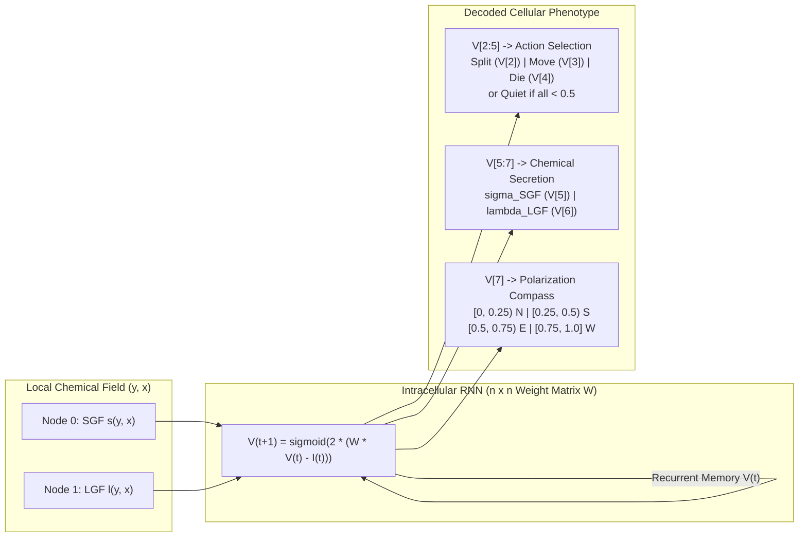
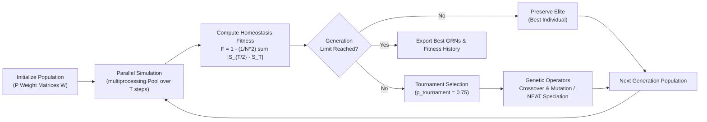
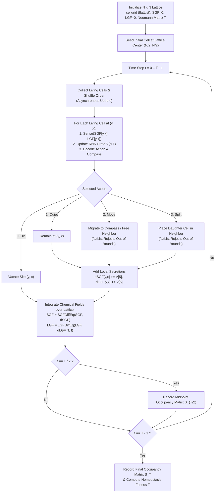

# Scientific Model and Software Architecture

## 1. Scientific Background and Thesis Objectives

This project implements the computational framework developed in the master's thesis **"Classification of Gene Regulatory Networks Driving Shape Homeostasis"** by **M.Sc. J. Esteban Pérez-Hidalgo** ([@j0sees](https://github.com/j0sees), supervised by **Ph.D. Philip Gerlee**; [original `v0.1.0` baseline `6c3fae7`](https://github.com/j0sees/Simulation-of-Gene-Regulatory-Networks-Driving-Shape-Homeostasis/tree/6c3fae7834a2ca502b1a439d7535c4adab1673f3)), with software architecture, Python 3 refactoring, web interface, and containerization engineered and maintained by **Reymer Vargas** ([@userravs](https://github.com/userravs), Independent Research Software Engineer, `v0.2.0`–`v0.3.0`). The model builds upon:

> Gerlee, P., Basanta, D., & Anderson, A. R. A. (2015). *The influence of cellular characteristics on the evolution of shape homeostasis*. Journal of the Royal Society Interface, 12(103), 20141222.

### Core Research Objectives
The thesis expands the Gerlee et al. framework to investigate how individual cellular capabilities—intracellular gene regulation, spatial polarization, and diffusible chemical signaling—give rise to self-organizing, homeostatic multicellular structures:

1. **Relaxing Network Constraints**: Replacing the constrained two-layer feedforward network of the original model with a fully connected **Recurrent Neural Network (RNN)** to explore a broader genotype and phenotype space.
2. **Enforcing Closed Spatial Boundaries**: Eliminating toroidal wrap-around artifacts at lattice borders so multicellular structures develop within bounded 2D domains.
3. **Behavioral Classification**: Demonstrating that evolved Gene Regulatory Networks (GRNs) that achieve shape homeostasis cluster into **three major behavioral classes**, defined by how cells balance proliferation, migration, quiescence, and apoptosis across environmental conditions.
4. **Graph Topology Exploration**: Evaluating how structural graph families (**Erdős-Rényi** random graphs, **Watts-Strogatz** small-world networks, and **Barabási-Albert** scale-free networks) influence homeostatic fitness and dynamical stability.

---

## 2. Mathematical Model

### Cellular Automata Lattice and Non-Toroidal Boundaries (`flatList`)
Cells inhabit a discrete 2D square lattice of size $N \times N$. At each discrete time step, every living cell is updated in random asynchronous order and adopts one of four behavioral states:

- **Quiet (`1`)**: Remains stationary at its current lattice site.
- **Move (`2`)**: Migrates to its preferred Von Neumann neighbor (if unoccupied), or to a random available Von Neumann neighbor.
- **Split (`3`)**: Divides and places a daughter cell with an identical genotype into its preferred (or another available) Von Neumann neighbor.
- **Die (`0`)**: Undergoes apoptosis and vacates its lattice site.

#### Closed Lattice Boundary Enforcement via `flatList`
In standard Python lists and NumPy arrays, negative indices (`grid[-1][x]`) wrap around to the opposite side of the array, causing the North and West lattice borders to behave like a **torus** while out-of-bounds positive indices (`grid[N][x]`) raise `IndexError`. To enforce **closed, non-toroidal boundaries** on all four borders without per-neighbor conditional branches, `core/tools.py` defines `flatList(list)`, which raises `IndexError` whenever `index < 0`. Both `Move()` and `Split()` catch `IndexError` to reject out-of-bounds neighbor coordinates uniformly on all four sides of the domain.

*Simulation snapshot showing discrete cell states alongside Short-range Growth Factor (SGF) and Long-range Growth Factor (LGF) concentration fields.*

---

### Chemical Signaling (SGF and LGF) and Neumann Boundary Conditions
Intercellular communication is mediated by two chemical concentration fields over the lattice:

1. **Short-range Growth Factor (SGF, $s$)**: Produced locally at rate $\sigma$ and decays at rate $\delta_s$ without spatial diffusion:
   $$\frac{\partial s}{\partial t} = \sigma - \delta_s s$$
   Updated via explicit Euler discretization in `SGFDiffEq`:
   $$s(t + \Delta t) = s(t) + \Delta t \left(\sigma - \delta_s s(t)\right)$$

2. **Long-range Growth Factor (LGF, $l$)**: Produced locally at rate $\lambda$, decays at rate $\delta_l$, and diffuses across the lattice with diffusion constant $D$:
   $$\frac{\partial l}{\partial t} = D \nabla^2 l + \lambda - \delta_l l$$
   Integrated numerically in `core/tools.py` (`LGFDiffEq`) via an alternating-direction semi-implicit Crank-Nicolson scheme using the discrete 1D Laplacian matrix $T$ (`GenerateTMatrix`):
   $$T = \begin{pmatrix} -1 & 1 & 0 & \cdots & 0 \\ 1 & -2 & 1 & \cdots & 0 \\ \vdots & \ddots & \ddots & \ddots & \vdots \\ 0 & \cdots & 1 & -2 & 1 \\ 0 & \cdots & 0 & 1 & -1 \end{pmatrix}$$
   Setting the corner entries $T_{0,0} = T_{N-1,N-1} = -1$ (instead of $-2$) enforces **zero-flux (homogeneous Neumann) boundary conditions** ($\nabla l \cdot \mathbf{n} = 0$) along the lattice perimeter so chemical factors do not leak out of the domain.

---

### Intracellular Gene Regulatory Network: From 2-Layer Feedforward to Recurrent Network

#### Original 2-Layer Feedforward Model (Gerlee et al., 2015)
In the original Gerlee et al. formulation, each cell's signaling network was restricted to a two-layer feedforward architecture with input-to-hidden weights $w$, hidden-to-output weights $W$, and threshold vectors $\theta$ and $\phi$:
$$V_j = \sigma\left(\beta \left(\sum_k w_{jk} I_k - \theta_j\right)\right), \qquad O_i = \sigma\left(\beta \left(\sum_j W_{ij} V_j - \phi_i\right)\right)$$
where $\sigma(x) = \frac{1}{1 + e^{-x}}$ and $\beta = 2$.

#### Generalized Recurrent Neural Network (RNN) in This Project
To allow arbitrary feedback loops, memory across time steps, and complex regulatory motifs, this project generalizes the intracellular controller into a single $n$-node **Recurrent Neural Network (`RecurrentNeuralNetwork`)** governed by a unified weight matrix $W \in [-1, 1]^{n \times n}$:
$$V_i(t + 1) = \frac{1}{1 + \exp\left(-2 \left(\sum_{j=0}^{n-1} W_{ij} V_j(t) - I_i(t)\right)\right)}$$

At each time step:
- **Inputs ($I$)**: Node `0` receives local SGF ($I_0 = s(y, x)$) and node `1` receives local LGF ($I_1 = l(y, x)$), with $I_k = 0$ for $k \ge 2$.
- **Action Selection (`V[2:5]`)**:
  - `V[2]` ($i_{\text{status}}$): Proliferation (`Split`)
  - `V[3]` ($j_{\text{status}}$): Migration (`Move`)
  - `V[4]` ($k_{\text{status}}$): Apoptosis (`Die`)
  - If all three activations are below the activation threshold $x_{\text{threshold}} = 0.5$, the cell remains **`Quiet`**. Otherwise, the action within $y_{\text{threshold}} = 0.01$ of the maximum activation $\max(V[2], V[3], V[4])$ is selected.
- **Chemical Secretion (`V[5:7]`)**:
  - `V[5]`: SGF production amount ($\sigma$)
  - `V[6]`: LGF production amount ($\lambda$)
- **Polarization Compass (`V[7]`)**:
  - Partitioned into four equal sub-intervals of $[0, 1]$ to set the cell's preferred Von Neumann neighbor: $[0, 0.25)$ North, $[0.25, 0.50)$ South, $[0.50, 0.75)$ East, and $[0.75, 1.0]$ West.

*Directed graph representation of a gene regulatory network with regulatory feedback loops.*

---

### Evolutionary Optimization and Behavioral Classes
To evolve networks that achieve **shape homeostasis** (a multicellular structure that self-organizes and maintains its spatial form over time), the genetic algorithm (`evolution/main_ga.py`) evaluates each candidate genotype over $T$ time steps and compares the binary cell occupancy matrix halfway through the simulation ($S_{T/2}$) against the final occupancy matrix ($S_T$):

$$F = 1 - \frac{1}{N^2} \sum_{i,j} \left|S_{T/2}(i, j) - S_T(i, j)\right|$$

Trivial or degenerate configurations—complete extinction, fewer than $1\%$ occupied lattice sites at $T/2$, or $100\%$ lattice saturation at $T$—are assigned $F = 0$.

*Best and average population fitness across generations during evolutionary optimization.*

#### Dynamical Systems Phase-Space Maps (`MapPlot`)
To classify evolved GRNs into behavioral regimes, each network can be probed across a 2D grid of `(SGF, LGF)` input concentrations to record its steady-state cellular decision (`0..4`). The `MapPlot` utility in `visualization/plot.py` renders these discrete decision regions across chemical concentration space, revealing the dynamical mechanism driving homeostasis.

---

## 3. Software Architecture

The codebase is organized into modular Python 3.11+ namespace packages:

| Directory / File | Responsibility |
|---|---|
| `core/cell_agent.py` | Defines the `cell` agent class (`Sense`, `GenerateStatus`, `Quiet`, `Move`, `Split`, `Die`). |
| `core/tools.py` | Implements `flatList`, Numba `@njit`-accelerated `SGFDiffEq`, `LGFDiffEq`, `RecurrentNeuralNetwork`, and matrix utilities. |
| `core/main.py` | Standalone simulation loop combining cellular automata updates, PDE integration, and Matplotlib rendering. |
| `evolution/main_ga.py` | Multiprocessing genetic algorithm with elitism and tournament selection. |
| `evolution/tools_ga.py` | Genetic operators (`Crossover`, `Mutate`, `DiracDelta`, `DifferentIndex`). |
| `evolution/neat_cell_agent.py` | Cell agent variant driven by a `neat-python` recurrent network genome. |
| `evolution/neat_parallel.py` | Parallel NEAT neuroevolution runner using `config/config-ca`. |
| `analysis/graph_generator.py` | Generates Erdős-Rényi, Watts-Strogatz, and Barabási-Albert graph ensembles for GRN topology studies. |
| `analysis/graph_evaluation.py` | Evaluates saved network populations in parallel and plots fitness distributions. |
| `visualization/plot.py` | Matplotlib `Environment` class, benchmark/fitness plots, and chemical phase-space `MapPlot`. |
| `visualization/web_app.py` | Interactive Streamlit and Plotly web interface for real-time browser simulation. |
| `examples/` | Self-contained scripts (`run_simulation.py`, `run_evolution.py`, `generate_documentation_images.py`). |
| `tests/` | `pytest` unit test suite covering PDE solvers, cell transitions, genetic operators, and network topologies. |

### Simulation Execution Flow

The diagram below illustrates the discrete time-step loop coupling asynchronous cellular updates with continuous SGF/LGF reaction-diffusion integration:

---

## 4. References and Further Reading

1. **Pérez-Hidalgo, J. E.** (2017). *Classification of Gene Regulatory Networks Driving Shape Homeostasis*. Master's Thesis, Department of Mathematical Sciences, University of Gothenburg & Chalmers University of Technology (supervised by Ph.D. Philip Gerlee).
2. **Gerlee, P., Basanta, D., & Anderson, A. R. A.** (2015). *The influence of cellular characteristics on the evolution of shape homeostasis*. Journal of the Royal Society Interface, 12(103), 20141222.
3. **Gerlee, P., Kim, E., & Anderson, A. R. A.** (2015). *Bridging scales in cancer progression: mapping genotype to phenotype using neural networks*. Seminars in Cancer Biology, 30, 30–41.
4. **Stanley, K. O., & Miikkulainen, R.** (2002). *Evolving Neural Networks through Augmenting Topologies*. Evolutionary Computation, 10(2), 99–127.
5. **Alon, U.** (2019). *An Introduction to Systems Biology: Design Principles of Biological Circuits* (2nd ed.). CRC Press.
6. **Murray, J. D.** (2003). *Mathematical Biology II: Spatial Models and Biomedical Applications* (3rd ed.). Springer.
7. **Deutsch, A., & Dormann, S.** (2017). *Cellular Automaton Modeling of Biological Pattern Formation* (2nd ed.). Birkhäuser.
8. **Eiben, A. E., & Smith, J. E.** (2015). *Introduction to Evolutionary Computing* (2nd ed.). Springer.
