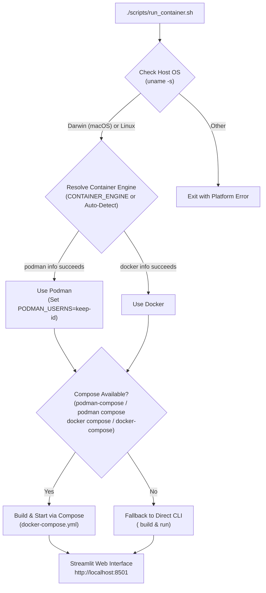

# Container Documentation (Podman & Docker)

## Overview

This repository includes container configurations (`Dockerfile`, `docker-compose.yml`, and `scripts/run_container.sh`) to run the simulation and web interface in a reproducible container environment on **macOS** and **Linux** using either **Podman** (including **Podman Desktop**) or **Docker**.

## Quick Start

### Prerequisites
- **Operating System**: macOS (`Darwin`) or Linux (`Linux`)
- **Container Engine**:
  - **Podman** (Podman Desktop on macOS or rootless Podman on Linux), **or**
  - **Docker** (Docker Desktop or Docker Engine)
- **Compose (Optional)**: `podman compose` / `podman-compose` or `docker compose` / `docker-compose` (if no Compose plugin is installed, `scripts/run_container.sh` automatically falls back to direct `podman` or `docker` CLI build/run commands).

### Running the Web Interface

```bash
# Auto-detects Podman or Docker, builds the image, and starts the web app
./scripts/run_container.sh

# Explicitly select Podman or Docker when both are installed
CONTAINER_ENGINE=podman ./scripts/run_container.sh
CONTAINER_ENGINE=docker ./scripts/run_container.sh
```

Open `http://localhost:8501` in your browser.



## Container Components

### `Dockerfile`
- Uses `python:3.12-slim` as the base image and copies the `uv` binary from `ghcr.io/astral-sh/uv:latest`.
- Installs `gcc` and `g++` for compiled scientific extensions.
- Installs project dependencies directly from `pyproject.toml` via `uv pip install --system --no-cache -r pyproject.toml`.
- Runs as a non-root user (`appuser`, UID `1000`).
- Exposes port `8501` and launches `streamlit run visualization/web_app.py`.

### `docker-compose.yml`
- Builds the image from the local `Dockerfile`.
- Maps host port `8501` to container port `8501`.
- Mounts the workspace directory (`.:/app`) and persistent data directory (`./data:/app/data`).

## Common Commands

```bash
# Run in detached (background) mode
docker-compose up -d --build

# Follow container logs
docker-compose logs -f

# Stop and remove containers
docker-compose down

# Run CLI scripts interactively inside the container
docker-compose run --rm grn-simulation bash
python examples/run_simulation.py
python examples/run_evolution.py
```
