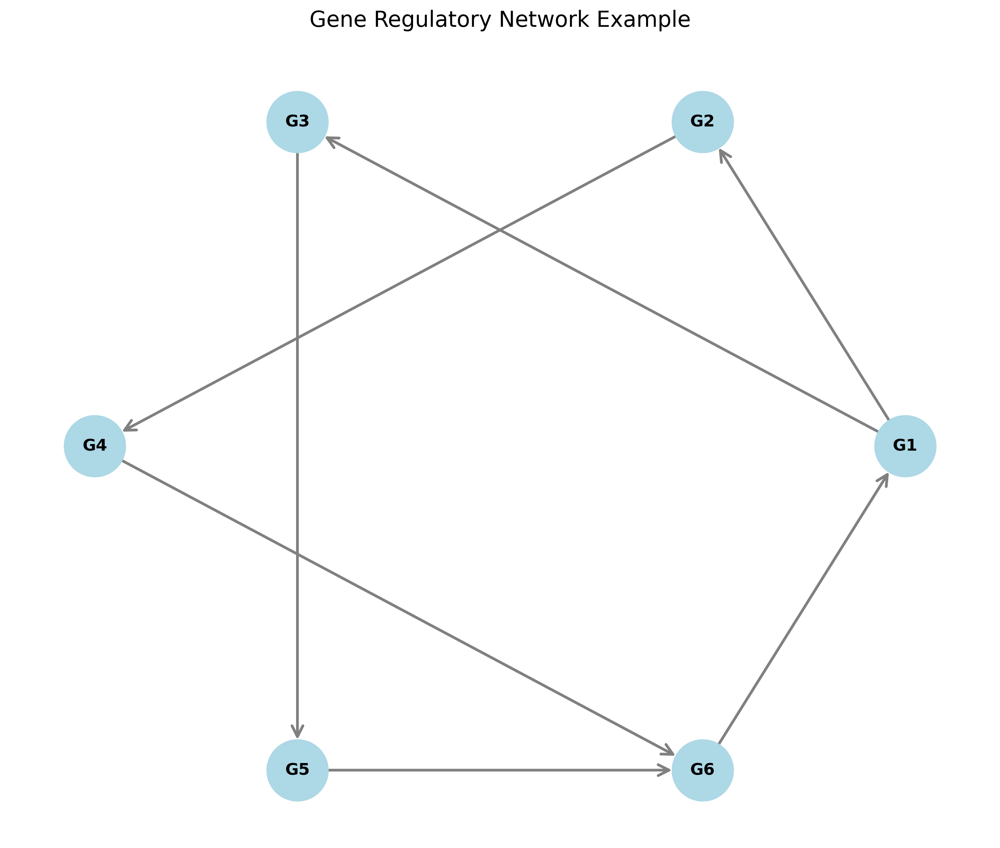
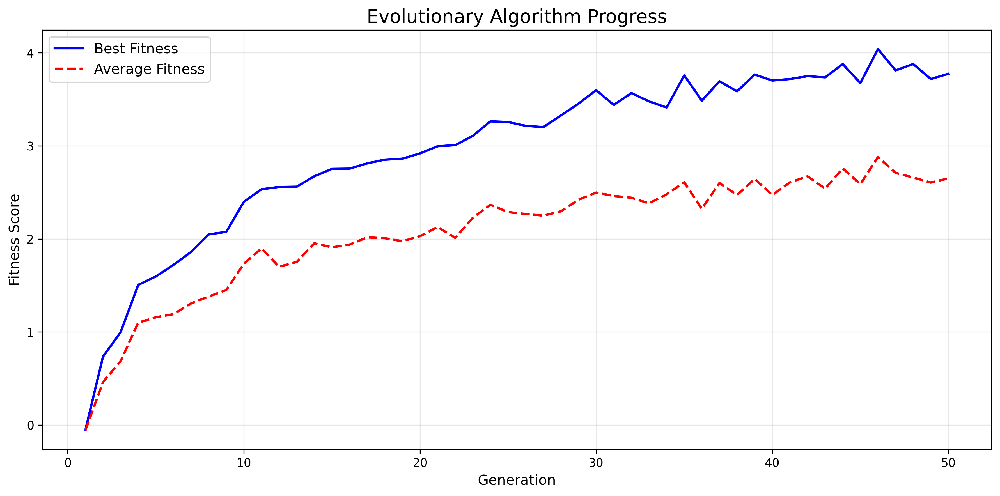

# Master's Thesis Summary: Gene Regulatory Networks Driving Shape Homeostasis

## Project Overview

This master's thesis project builds upon the computational framework introduced by **Gerlee et al. (2015)** (*"The influence of cellular characteristics on the evolution of shape homeostasis"*, *Journal of the Royal Society Interface*, 12(103), 20141222).

The framework models developing multicellular structures on a two-dimensional discrete lattice to study how individual cellular characteristics give rise to emergent shape homeostasis. It combines intracellular signaling networks with local capabilities such as cell polarization (orientation) and intercellular communication via diffusible growth factors.

## Model Description

Each cell on the lattice adopts one of four discrete actions at each time step: **quiet**, **move**, **die**, or **split** (divide).

Action selection is governed by an intracellular recurrent neural network (representing a Gene Regulatory Network, or GRN) that receives local environmental inputs from the grid. At each step, the network outputs:

1. The cell's discrete behavioral state (`quiet`, `move`, `die`, or `split`),
2. The production rate of diffusible chemical factors, and
3. A spatial orientation vector (polarization compass) on the grid.

Every cell carries an identical neural network genotype inherited from its parent cell during division. To discover genotypes that self-organize into stable, homeostatic multicellular structures, an evolutionary algorithm optimizes the network weights across generations.

*Simulation environment showing cells in discrete states alongside Short-range Growth Factor (SGF) and Long-range Growth Factor (LGF) concentration fields.*

## Implementation Features

### Core Components
- **Cellular Automata**: Discrete 2D lattice modeling spatial occupancy and local neighborhood interactions.
- **Recurrent Neural Networks**: Intracellular gene regulatory networks mapping local chemical inputs to cellular actions.
- **Chemical Signaling**: Reaction-diffusion dynamics for Short-range Growth Factor (SGF) and Long-range Growth Factor (LGF).
- **Evolutionary Optimization**: Parallel genetic algorithm and NEAT neuroevolution for optimizing network parameters.

*Example directed gene regulatory network illustrating regulatory connections and feedback loops.*

### Technical Enhancements
- **Vectorized Diffusion Solver**: Matrix-based finite-difference updates for SGF and LGF fields.
- **Parallel Evaluation**: Multiprocessing support for evaluating candidate genomes across CPU cores.
- **Network Topology Analysis**: Graph generators for testing Erdős-Rényi, Watts-Strogatz, and Barabási-Albert architectures.
- **Interactive Web Interface**: Streamlit and Plotly web application for real-time visualization.
- **Containerized Environment**: Docker configuration for reproducible execution across platforms.

*Best and mean population fitness progression during genetic algorithm optimization.*

## Research Objectives and Outcomes

The research investigates:

- **Minimal Cellular Capabilities**: Identifying the minimal set of cellular behaviors and signaling mechanisms required for shape homeostasis.
- **Behavioral Classification**: Categorizing evolved GRNs into three primary behavioral classes that achieve homeostatic stability.
- **Environmental Robustness**: Evaluating how evolved multicellular collectives respond to varied chemical and spatial conditions.
- **Topology-Function Relationships**: Analyzing how structural graph properties of GRNs relate to developmental stability.

## Software Architecture

The repository organizes the research implementation into modular packages:

- **`core/`**: Cellular automata engine, cell agent definition, and PDE solvers.
- **`evolution/`**: Genetic algorithm operators, tournament selection, elitism, and parallel fitness evaluation.
- **`visualization/`**: Matplotlib plotting utilities for lattice states and chemical maps.
- **`analysis/`**: Network topology generators and graph evaluation scripts.
- **`web_app.py`**: Browser-based simulation interface built with Streamlit and Plotly.
