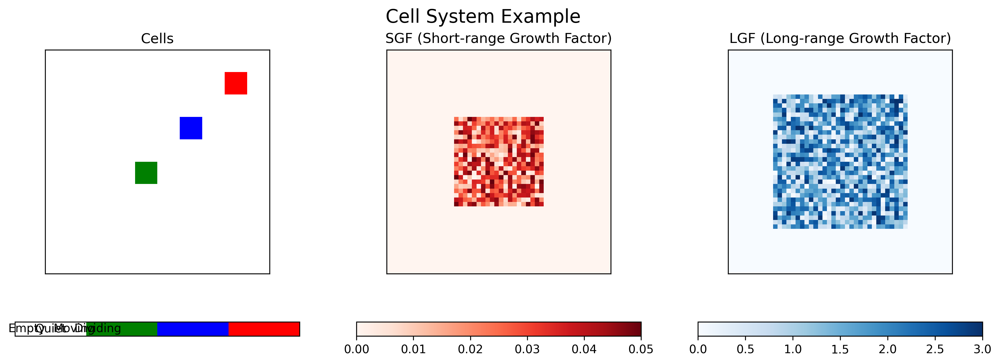

# Web Interface Documentation

## Overview

The Gene Regulatory Network simulation includes an interactive web application built with **Streamlit** and **Plotly**. It provides browser-based parameter configuration, simulation playback controls, and real-time heatmaps of cell states and chemical signaling fields.

## Quick Start

### Prerequisites

- **Docker & Docker Compose** (recommended; no local Python installation required)
- **Python 3.11+** and **[uv](https://docs.astral.sh/uv/)** (for local execution without Docker)

### Running the Web Interface

#### Option 1: Docker (Recommended)

```bash
# Build and start the containerized web application
./run_docker.sh

# Open in your browser: http://localhost:8501
```

#### Option 2: Local Execution with `uv`

```bash
# Use the local launcher script (syncs dependencies via uv automatically)
./run_web_app.sh

# Or run Streamlit directly with uv
uv sync
uv run streamlit run web_app.py --server.port 8501 --server.address 0.0.0.0
```

## Interface Features

### Simulation Controls

The web application is organized into three main tabs:

#### 1. Simulation Tab
- **Start / Pause / Reset Controls**: Manage simulation execution interactively.
- **Real-Time Parameter Adjustment**: Configure network size, lattice dimensions, and step counts from the sidebar.
- **Live Visualization**: Inspect side-by-side heatmaps of cell states, SGF levels, and LGF levels.
- **Progress Tracking**: Monitor the current time step and overall completion percentage.

#### 2. Analysis Tab
- **Fitness Analysis**: Generate and inspect fitness progression curves across evolutionary generations.
- **Interactive Charts**: Hover, zoom, and export plots directly from the browser.

#### 3. About Tab
- **Model Overview**: Summary of the cellular automata, chemical signaling, and recurrent neural network architecture.
- **Project Background**: Authorship and research context.

### Parameter Controls

#### Simulation Parameters
- **Number of Nodes**: Size of the intracellular neural network (range: `5`–`50`, default: `25`).
- **Lattice Size**: Dimensions of the 2D simulation grid (range: `10`–`100`, default: `50`).
- **Time Steps**: Total simulation iterations to execute (range: `10`–`500`, default: `100`).

#### Network Topologies
- **Random**: Uniformly initialized weight connections.
- **Erdős-Rényi**: Random graph with fixed edge probability.
- **Watts-Strogatz**: Small-world network with local clustering and random rewiring.
- **Barabási-Albert**: Scale-free network generated via preferential attachment.

### Visualization Features

#### Real-Time Heatmaps
- **Cells**: Discrete cell states (`0`: Empty, `1`: Quiet, `2`: Moving, `3`: Divided).
- **SGF Concentration**: Short-range Growth Factor spatial distribution.
- **LGF Concentration**: Long-range Growth Factor spatial distribution.



*Example output showing cell states alongside SGF and LGF concentration fields.*

#### Interactive Plot Controls
- **Zoom and Pan**: Inspect specific spatial regions of the lattice.
- **Hover Inspection**: View exact coordinates, state values, and chemical concentrations.
- **Snapshot Export**: Download plots as PNG images via the Plotly toolbar.

## Technical Architecture

### Frontend
- **Streamlit**: Reactive web application framework (`web_app.py`).
- **Plotly**: Interactive subplot heatmaps and line charts.
- **Pandas / NumPy**: Array and tabular data handling.

### Backend
- **Core Simulation (`core/`)**: Cellular automata rules, cell agents, and reaction-diffusion equations.
- **Evolutionary Engine (`evolution/`)**: Genetic algorithm operators and fitness evaluation.

### Containerization
- **Docker**: Packages Python 3.12, `uv`, system build tools (`gcc`, `g++`), and Python dependencies.
- **Port Mapping**: Exposes port `8501` to the host machine.
- **Volume Mounting**: Mounts `./data` to `/app/data` for persisting output files.

## Typical Workflows

### Running a Simulation
1. Open `http://localhost:8501` in a browser.
2. Select the **Simulation** tab.
3. Set **Number of Nodes**, **Lattice Size**, **Time Steps**, and **Network Type** in the left sidebar.
4. Click **Start Simulation**.
5. Use **Pause** to inspect a specific frame or **Reset** to clear the state.

### Comparing Network Topologies
1. Run a baseline simulation with **Random** topology and note the spatial organization.
2. Reset the simulation and switch **Network Type** to **Watts-Strogatz** or **Barabási-Albert**.
3. Compare the resulting cell distribution and growth factor profiles.

### Inspecting Fitness Trends
1. Select the **Analysis** tab.
2. Click **Generate Fitness Analysis** to render best vs. average fitness trajectories across generations.

## Troubleshooting

### Web Interface Does Not Load
- **Verify Docker is running**: Run `docker info`.
- **Check port availability**: Ensure port `8501` is not occupied (`lsof -i :8501`).
- **Inspect logs**: Run `docker-compose logs` to check for startup errors.

### Module Import Errors
- **Rebuild the container image**: Run `docker-compose down && docker-compose up --build`.
- **Verify local dependencies**: Run `uv sync` when running outside Docker.

### Slow Simulation Updates
- Reduce **Lattice Size** (e.g., `25`–`40`) or **Time Steps** for faster interactive rendering.
- Run locally via `./run_web_app.sh` to avoid container virtualization overhead on resource-constrained machines.

## References

- **Streamlit Documentation**: https://docs.streamlit.io/
- **Plotly Python Graphing Library**: https://plotly.com/python/
- **Docker Documentation**: https://docs.docker.com/
